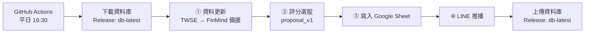

# 多策略自動選股系統（stock-system）

以台股為標的的**每日自動選股管線**：每個交易日收盤後自動更新資料、以規則式評分系統替股票池打分數，將達標股票寫入 Google Sheet 並推播到 LINE。整套流程由 GitHub Actions 排程執行，不需要開電腦。

> ⚠️ 本系統為學生專題的研究用途，所有訊號僅供研究參考，**不構成任何投資建議**。

---

## 功能

- **自動更新資料**：優先抓證交所（TWSE）當日盤後資料，抓不到再用 FinMind API 補齊缺口
- **規則式評分選股**：技術面 50 分＋基本面／籌碼面 50 分，滿分 100 分，依分數分為「強烈推薦」與「觀察清單」
- **Google Sheet 追蹤**：每日選股紀錄、每檔股票推薦後的累積報酬
- **LINE 推播**：每日選股報告以廣播（broadcast）發給所有已加官方帳號好友的人；管線異常則以私訊（push）只通知管理者
- **全自動排程**：GitHub Actions 平日台灣時間 16:30 執行

## 系統流程



| 步驟 | 說明 | 失敗時 |
|---|---|---|
| ① 資料更新 | 平日 15:00 後且證交所 T86 已有當日資料 → 走當日路徑；否則檢查資料庫缺口，用 FinMind 增量補齊（隔日、連假後、斷網後都能自動補） | 通知管理者並中止 |
| ② 評分選股 | 以**資料庫最新交易日**為基準日，替股票池每一檔計算技術面＋基本面分數 | 通知管理者並中止 |
| ③ Google Sheet | 寫入「每日選股紀錄」（同日同股不重複寫入），重算「推薦追蹤」 | 通知，但**繼續推播** |
| ④ LINE 推播 | 依評級分組列出達標股票，附免責聲明，以 broadcast 發給所有好友；當天無達標股票則不推播 | 記錄失敗 |

## 選股規則（proposal_v1）

| 類別 | 條件 | 配分 |
|---|---|---|
| 技術面 | 收盤價站上年線（MA240） | 15 |
| 技術面 | 近 5 日內 MA20 上穿 MA60（黃金交叉） | 15 |
| 技術面 | 近 5 日內 MACD 柱狀體由負翻正 | 10 |
| 技術面 | RSI(14) 介於 40～60 | 5 |
| 技術面 | 價漲量增 | 5 |
| 基本面 | 殖利率 > 4% | 15 |
| 基本面 | 月營收年增率 > 10% | 15 |
| 基本面 | EPS 連續兩季成長 | 10 |
| 基本面 | ROE > 10% | 5 |
| 籌碼面 | 外資或投信連續 3 日買超 | 5 |

- **≥ 80 分：🔥 強烈推薦**　**≥ 60 分：👀 觀察清單**
- 基本面資料一律使用「公告後才能取得」的日期（月營收：次月 10 日；財報：季底後 45 天，Q4 為 90 天），避免偷看未來資料
- 所有門檻集中在 `daily_run.py` 的 `PROPOSAL_PARAMS`；新策略可在 `STRATEGIES` 註冊，改 `ACTIVE_STRATEGY` 一行即可切換

## 專案結構

```
stock-system/
├── daily_run.py                 # 每日管線主程式（資料更新 → 選股 → Sheet → LINE）
├── config.py                    # 設定載入器：環境變數優先，本機可用 config_local.py 覆蓋
├── requirements.txt             # 套件清單
├── .github/workflows/daily.yml  # GitHub Actions 排程設定
└── .gitignore                   # 排除金鑰、資料庫與暫存檔
```

不會上傳到 GitHub 的檔案：`config_local.py`（本機金鑰）、`service_account.json`（Google 金鑰）、`stock_data.db`（資料庫，改存 Release）。

## 資料庫（SQLite：`stock_data.db`）

| 資料表 | 內容 | 來源 |
|---|---|---|
| `daily_price` | 日 K（開高低收、成交量） | TWSE／FinMind |
| `institutional` | 三大法人買賣超 | TWSE T86／FinMind |
| `valuation` | 本益比、股價淨值比、殖利率 | FinMind |
| `monthly_revenue` | 月營收（含可使用日期） | FinMind |
| `financial_statement` | 損益表科目（EPS、稅後淨利） | FinMind |
| `balance_sheet` | 資產負債表科目（股東權益） | FinMind |
| `selection_log` | 每日評分結果 | 本系統 |
| `run_log` | 每次執行各步驟的成功／失敗紀錄 | 本系統 |
| `stock_info` | 股票代號與名稱 | 本系統 |

資料庫每天會變大（已超過 140MB），所以**不 commit 進 git**，而是存成 GitHub Release（tag：`db-latest`）的附件，每次執行完用 `--clobber` 覆蓋上傳，GitHub 上永遠只保留最新一份。

## 部署到 GitHub Actions

### 1. 建立資料庫 Release（只需一次）
在 GitHub 網頁 → Releases → 建立 tag 為 `db-latest` 的 Release，把初始的 `stock_data.db` 當附件上傳。

### 2. 設定 Secrets
Settings → Secrets and variables → Actions → New repository secret：

| Secret 名稱 | 說明 |
|---|---|
| `FINMIND_TOKEN` | FinMind API token（免費註冊取得） |
| `LINE_CHANNEL_ACCESS_TOKEN` | LINE 官方帳號的 Channel access token |
| `LINE_USER_ID` | 管理者的 LINE 使用者 ID（U 開頭），只用來接收管線異常通知 |
| `GSHEET_SERVICE_ACCOUNT_JSON` | Google 服務帳號金鑰 JSON 的**完整內容** |
| `SHEET_URL` | Google Sheet 網址（需共用給服務帳號的 email） |
| `GSHEET_NAME` | Google Sheet 名稱（預設：選股系統追蹤） |

### 3. 執行
- 自動：平日 UTC 08:30（台灣 16:30）
- 手動：Actions → daily-stock-pipeline → **Run workflow**

> GitHub 排程不保證準時，尖峰時段可能延遲 10～30 分鐘；程式內建日期防呆，延遲或重跑都不會重複推播。

## 本機執行

```bash
pip install -r requirements.txt
```

在同一資料夾建立 `config_local.py`（已被 `.gitignore` 排除）：

```python
FINMIND_TOKEN = "你的 token"
LINE_CHANNEL_ACCESS_TOKEN = "你的 token"
LINE_USER_ID = "U 開頭的 ID"
GSHEET_KEY_PATH = r"C:\路徑\service_account.json"
SHEET_URL = "https://docs.google.com/spreadsheets/d/..."
# 測試時可關掉推播或 Sheet：
# ENABLE_LINE = False
# ENABLE_GSHEET = False
```

把 `stock_data.db` 放在同一資料夾後執行：

```bash
python daily_run.py
```

## 容錯設計

- **雙路徑資料更新**：證交所當日資料優先，失敗或尚未更新時自動改用 FinMind 補缺口
- **日期防呆**：一律以台灣時區判斷；同日重跑、假日、連假後執行都能得到正確的基準日
- **防重複推播**：同一交易日已推播過就不再推播
- **非關鍵站隔離**：Google Sheet 失敗不影響 LINE 推播
- **執行紀錄**：每一步驟的結果寫入 `run_log`，失敗時用 LINE push 私訊通知管理者（不會廣播給一般好友）
- **自我修復**：資料庫被重建或還原時，自動補齊必要的輔助資料表

## 使用技術

Python · pandas · SQLite · FinMind API · TWSE OpenAPI · gspread（Google Sheets API）· LINE Messaging API · GitHub Actions · GitHub Releases

## 免責聲明

本專案為學生專題作品。回測與研究結果顯示，在目前的股票池與設定下，尚未有模型或規則被證實能穩定、顯著地打敗大盤。系統輸出僅供研究與學習參考，不構成任何投資建議，使用者應自行判斷並承擔投資風險。
